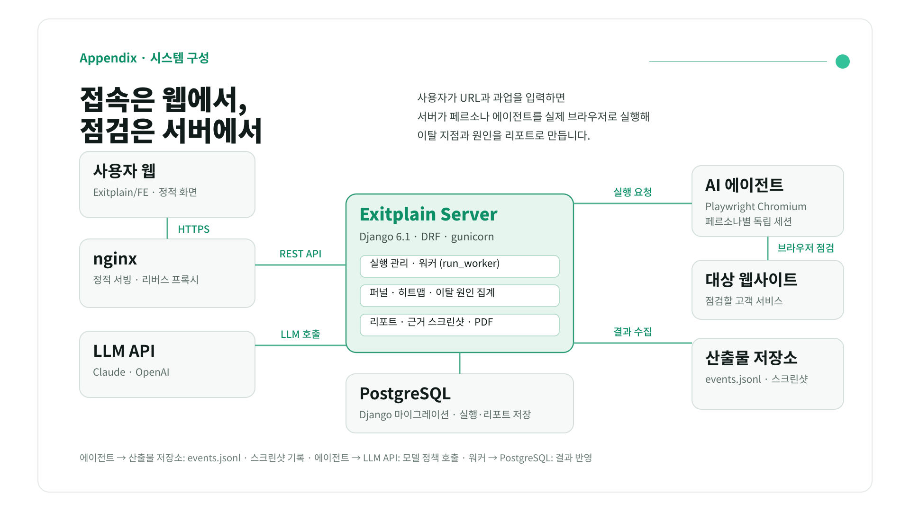
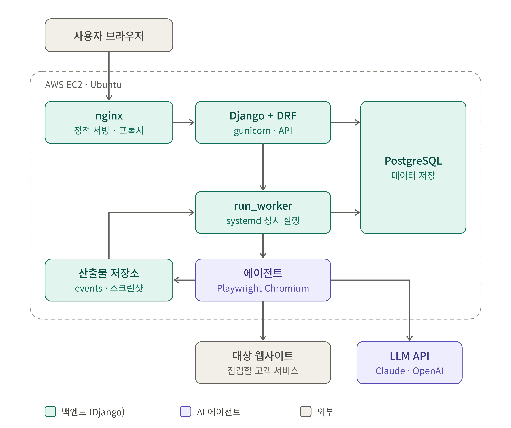
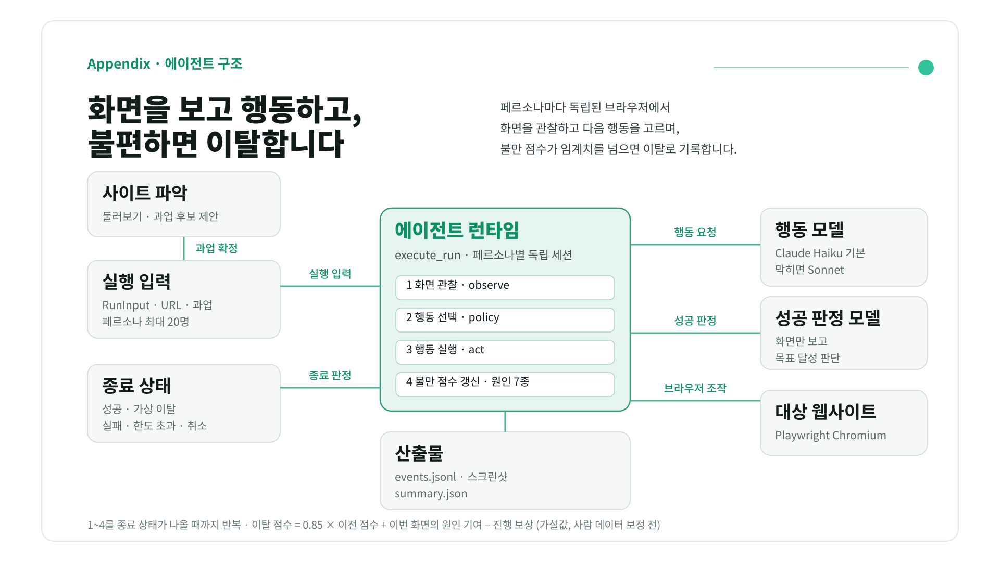

# Exitplain BE

> **AI 페르소나가 실제 브라우저로 사이트를 써 보고, 어디서 왜 이탈하는지 알려 주는 UX 점검 서비스**의 백엔드·에이전트 저장소입니다.

[API 명세서](docs/API_SPEC.md) · [배포 가이드](deploy/README.md) · [CI/CD](deploy/CICD.md) · 프론트엔드: [Exitplain/FE](https://github.com/Exitplain/FE)

<!-- 이미지는 docs/images/ 폴더에 넣고 경로를 맞춰 주세요 -->

<br>

## 💡 팀원 소개

<table>
  <tr>
    <td align="center" width="130"><b>장서후</b></td>
    <td align="center" width="130"><b>고명준</b></td>
    <td align="center" width="130"><b>이정능</b></td>
    <td align="center" width="130"><b>심재현</b></td>
    <td align="center" width="130"><b>이정은</b></td>
    <td align="center" width="130"><b>정혜원</b></td>
  </tr>
  <tr>
    <td align="center"></td>
    <td align="center"></td>
    <td align="center"></td>
    <td align="center"></td>
    <td align="center"></td>
    <td align="center"></td>
  </tr>
  <tr>
    <td align="center">디자인</td>
    <td align="center">프론트엔드</td>
    <td align="center">프론트엔드</td>
    <td align="center">기획·AI</td>
    <td align="center">백엔드</td>
    <td align="center">백엔드</td>
  </tr>
  <tr>
    <td align="center"><a href="https://github.com/SoWho-J">@SoWho-J</a></td>
    <td align="center"><a href="https://github.com/kmj0973">@kmj0973</a></td>
    <td align="center"><a href="https://github.com/jeongneung">@jeongneung</a></td>
    <td align="center"><a href="https://github.com/Jaehyeon-kr">@Jaehyeon-kr</a></td>
    <td align="center"><a href="https://github.com/abdc5307">@abdc5307</a></td>
    <td align="center"><a href="https://github.com/HyewonC80">@HyewonC80</a></td>
  </tr>
</table>

<br>

## ✨ 주요 기능

1. **사이트 확인** — URL(또는 공개 git 저장소의 정적 사이트 코드)을 받아 둘러보고, 확인할 과업 후보를 제안
2. **계획 확정** — 과업·타겟 고객·연령대·세그먼트 인원을 정하고 확정하면, 그 기준으로 페르소나를 생성
3. **실행** — 페르소나마다 독립된 브라우저로 과업을 수행하고, 진행·발화·화면을 실시간으로 수집
4. **리포트** — 단계별 이동(퍼널), 이탈 원인 Top 3, 세그먼트 × 단계 히트맵, 근거 스크린샷, 방문별 종료 설명, Markdown·PDF 내보내기
5. **실측 · 보정** — 실제 고객 데이터(수집 스크립트·CSV)를 모아 예측과 비교하고, 페르소나 수치를 보정

<br>

## 🏗️ 시스템 구성

> **접속은 웹에서, 점검은 서버에서**
> 사용자가 URL과 과업을 입력하면 서버가 페르소나 에이전트를 실제 브라우저로 실행해 이탈 지점과 원인을 리포트로 만듭니다.

<p align="center">
  
</p>

| 구성 요소 | 역할 |
|---|---|
| **사용자 웹** (Exitplain/FE) | 테스트 설정·실행 화면·리포트 |
| **nginx** | HTTPS, 정적 파일 서빙, `/api/` 리버스 프록시 |
| **Django + DRF** (gunicorn) | REST API: 프로젝트·계획·실행·리포트·실측·보정 |
| **run_worker** (systemd) | 대기 중인 실행을 가져와 과업 × 반복마다 에이전트를 실행하고, 진행 기록을 DB로 옮김 |
| **AI 에이전트** | 페르소나마다 독립된 Chromium 세션으로 대상 사이트를 직접 사용 |
| **산출물** | `events.jsonl`, 스크린샷, `summary.json` (서버 디스크) |
| **PostgreSQL** | 실행·세션·리포트 저장 |
| **LLM API** | 행동 판단·성공 판정·페르소나 생성 등 판단이 필요한 단계에서만 호출 |

### 배포 구조 (AWS EC2)

<p align="center">
  
</p>

<br>

## 🤖 에이전트 구조

> **화면을 보고 행동하고, 불편하면 이탈합니다**
> 페르소나마다 독립된 브라우저에서 화면을 관찰하고 다음 행동을 고르며, 불만 점수가 임계치를 넘으면 이탈로 기록합니다.

<p align="center">
  
</p>

> 행동 모델: 데모 쇼핑몰은 규칙 기반(`shop_scripted`)으로 LLM 없이 실행하고, 일반 사이트는 Claude(기본 Haiku, 막히면 Sonnet)로 실행합니다.

1. **화면 관찰** (`observe`): 현재 화면의 텍스트·입력칸·버튼 등을 읽습니다.
2. **행동 선택** (`policy`): 다음 행동을 고릅니다.
3. **행동 실행** (`act`): 클릭·입력·스크롤을 실제 브라우저에서 실행합니다.
4. **불만 점수 갱신**: 7가지 원인(입력 부담, 탐색 실패, 비용 충격, 가치 불명확, 신뢰 부족, 기술 오류·지연, 접근성 장벽)의 기여를 더해 점수를 갱신합니다.

1~4를 종료 상태(성공 · 가상 이탈 · 실패 · 한도 초과 · 취소)가 나올 때까지 반복합니다.

```
이탈 점수 = 0.85 × 이전 점수 + 이번 화면의 원인 기여 − 진행 보상
```

> 모든 수치는 사람 데이터로 보정하기 전의 **가설값**입니다. 리포트의 이탈은 실제 사용자 이탈률이 아니라 모델이 판정한 근거입니다.

<br>

## 🛠️ 기술 스택

**Backend** &nbsp;


**AI / Agent** &nbsp;


**Infra** &nbsp;


### Backend
| 구분 | 기술 |
|---|---|
| Language / Framework | Python 3.12+, Django 6.1, Django REST Framework |
| Database | PostgreSQL |
| Auth | 이메일 인증 코드 로그인, Google OAuth (`google-auth`), 세션 + CSRF |
| Security | 테스트 계정 비밀번호 암호화 (`cryptography`, AWS KMS 선택 지원) |
| Async Worker | systemd 상시 워커 + subprocess 에이전트 실행, `events.jsonl` 실시간 수집 |
| Report | 단계별 이동(퍼널), 이탈 원인 Top 3, 세그먼트 × 단계 히트맵, 근거 스크린샷, 방문별 종료 설명, Markdown·PDF 내보내기 |
| 실측 · 보정 | 실제 고객 수집 스크립트·CSV, 예측 대비 비교, 페르소나 수치 보정 |
| LLM 연동 | Anthropic SDK (페르소나 생성, 직접 추가한 과업의 성공 기준) |

### AI / Agent
| 구분 | 기술 |
|---|---|
| Browser Automation | Playwright (Chromium) |
| Schema | Pydantic (실행 입력 `RunInput`, 모델 출력 구조화) |
| Persona Agent | 페르소나별 독립 브라우저 세션 (최대 20명), 불만 점수 기반 이탈 판정, 성공 경로·성공 기준 판정 |
| LLM | Anthropic SDK (Claude Haiku 기본, 막히면 Sonnet), OpenAI SDK (선택) |
| Evidence | 이벤트 JSONL, 스크린샷, 관찰 JSON, `summary.json` |
| Verification | pytest 기반 검증 하네스 (`harness/`, `tests/`) |

### Infra / DevOps
| 구분 | 기술 |
|---|---|
| Server | AWS EC2 (Ubuntu, 서울 리전), Elastic IP |
| Web Server | nginx → gunicorn |
| Process Manager | systemd (`exitplain-web`, `exitplain-worker`) |
| CI | GitHub Actions (`manage.py check`, 마이그레이션 누락 검사, Django 테스트) |
| CD | main 머지 → CI 통과 시 자동 배포 (GitHub OIDC → AWS SSM, SSH 미사용) |
| Branch Strategy | feature → develop → main (운영 배포는 main만) |

<br>

## 📁 저장소 구조

```
BE/
├── agent/               # 페르소나 브라우저 에이전트 (관찰·행동·불만 점수·성공 판정)
├── backend/             # Django 프로젝트
│   ├── accounts/        #   로그인(이메일·Google), 워크스페이스
│   ├── projects/        #   프로젝트, 진단 루프 상태
│   ├── discoveries/     #   사이트 확인, 과업 후보
│   ├── sources/         #   git 저장소 코드 받기·미리보기
│   ├── plans/           #   테스트 계획, 확정본(스냅샷)
│   ├── personas/        #   페르소나 생성 (규칙 기반 · LLM)
│   ├── testaccounts/    #   테스트 계정 (암호화 저장)
│   ├── runs/            #   실행, 워커(run_worker)
│   ├── reports/         #   리포트 집계, 방문 상세, 발견한 문제, 내보내기
│   ├── measurements/    #   실측 수집·단계 매핑
│   └── calibrations/    #   예측 맞추기(보정)
├── deploy/              # 배포 스크립트, systemd·nginx 설정, 배포 문서
├── docs/                # API 명세, 데이터 계약, ERD
├── harness/ · tests/    # 에이전트 검증 하네스, pytest
└── pyproject.toml       # 에이전트 패키지 (playwright, pydantic, 선택: anthropic·openai)
```

<br>

## 🚀 로컬 실행

```bash
git clone https://github.com/Exitplain/BE.git
cd BE
python3 -m venv .venv
source .venv/bin/activate

pip install -r backend/requirements.txt
pip install -e '.[model,test]'
python -m playwright install chromium

cd backend
python manage.py migrate
python manage.py runserver          # API 서버
python manage.py run_worker         # 다른 터미널에서: 실행 워커
```

- 환경변수(DB, API 키, 기능 설정)는 [배포 가이드](deploy/README.md)의 표를 참고합니다.
- 데모 쇼핑몰은 별도 터미널에서 `python -m agent.shop --port 4173` 으로 실행합니다.

<br>

## ✅ 테스트

```bash
# Django 백엔드 (backend 폴더에서)
PYTHONPATH=.. python manage.py test

# 에이전트 (저장소 루트에서)
python -m pytest
```

